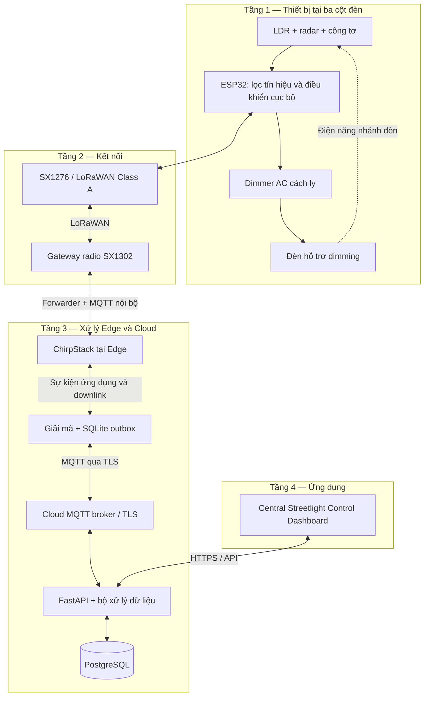
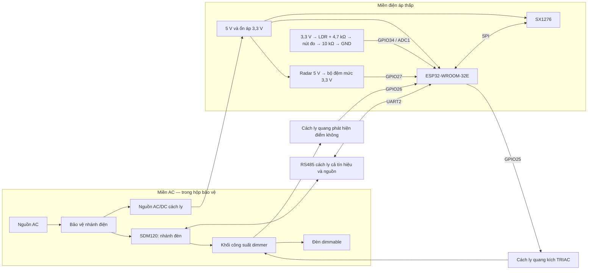
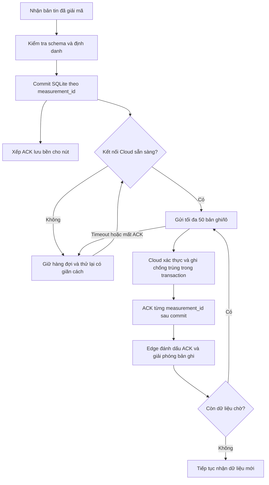
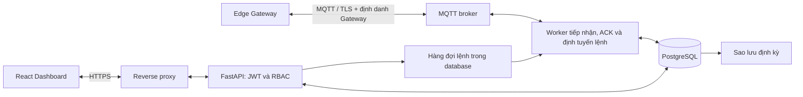

# Đề cương Đèn đường thông minh tự động điều chỉnh độ sáng

**Đề tài 23 — Lĩnh vực Thành phố thông minh (Smart City)**  
**Môn học:** Internet of Things  
**Đơn vị:** Trường Đại học Công Thương TP. Hồ Chí Minh, Khoa Công nghệ thông tin  
**Nhóm:** 7

| Thành viên | Mã số sinh viên |
| --- | --- |
| Quang Nhật Hưng | 2001230328 |
| Nguyễn Văn Anh Tuấn | 2001230863 |

Đề tài đề xuất hệ thống ba nút đèn có khả năng tự điều chỉnh mức sáng theo ánh sáng môi trường và chuyển động, đồng thời gửi dữ liệu về hệ thống quản lý tập trung. Tài liệu trình bày kiến trúc, thiết kế phần cứng, xử lý dữ liệu, kết nối LoRaWAN và ứng dụng Central Streetlight Control Dashboard để làm cơ sở phát triển bài tập.

Phạm vi gồm Câu 1 và đầy đủ các phần 2A, 2B, 2C. Các vai trò Hardware & Embedded, Networking & Edge, Cloud & Security là các phần chuyên môn của đề bài; không đồng nghĩa với việc bổ sung thành viên thứ ba. Đây là đề cương thiết kế, chưa phải báo cáo nghiệm thu mô hình. Các thông số tự chọn và phép tính minh họa được ghi rõ để phân biệt với thông số nhà sản xuất và kết quả đo thực tế.

## Mục lục

1. [Mở đầu và xác định bài toán](#mo-dau)
2. [Câu 1 — Kiến trúc IoT bốn tầng](#cau-1)
3. [Câu 2A — Phần cứng và hệ nhúng](#cau-2a)
4. [Câu 2B — Mạng và xử lý tại Edge](#cau-2b)
5. [Câu 2C — Cloud và bảo mật](#cau-2c)
6. [Đánh giá và minh chứng dự kiến](#danh-gia)
7. [Kết luận và hướng phát triển](#ket-luan)
8. [Tài liệu tham khảo](#tai-lieu)

<a id="mo-dau"></a>

## 1. Mở đầu và xác định bài toán

### 1.1. Vấn đề thực tế

Đèn đường vận hành theo lịch cố định hoặc giữ công suất cao suốt đêm có thể tiêu thụ điện không cần thiết khi ít người qua lại. Việc kiểm tra thủ công cũng khiến tình trạng mất kết nối, đèn không sáng hoặc tiêu thụ điện bất thường khó được phát hiện sớm. Hệ thống cần kết hợp điều khiển tại từng cột đèn với giám sát tập trung để thích ứng với môi trường và hỗ trợ bảo trì.

### 1.2. Mục tiêu

- Nhận biết ngày, hoàng hôn và đêm bằng cảm biến ánh sáng LDR.
- Phát hiện chuyển động bằng radar vi sóng và tăng mức sáng tại nút đèn mà không phải chờ Cloud.
- Giảm mức sáng sau một khoảng thời gian không còn chuyển động.
- Đo điện áp, dòng điện, công suất tác dụng và điện năng để theo dõi vận hành.
- Gửi dữ liệu qua LoRaWAN, lưu lịch sử và điều khiển từ Dashboard theo quyền người dùng.
- Duy trì điều khiển cục bộ khi mất mạng; lưu và gửi bù dữ liệu trong giới hạn bộ đệm.
- Phát hiện dấu hiệu bất thường, phân biệt lỗi đo, lỗi đèn và mất liên lạc.

### 1.3. Phạm vi và các lựa chọn thiết kế

| Nội dung | Phương án sử dụng trong đề cương |
| --- | --- |
| Quy mô | Ba nút `SL-001`, `SL-002`, `SL-003`; một Edge Gateway; một hệ thống Cloud |
| Vi điều khiển | ESP32-DevKitC dùng module ESP32-WROOM-32E |
| Cảm biến | LDR; radar vi sóng phát hiện chuyển động; công tơ điện có Modbus RTU |
| Chấp hành | Dimmer AC có cách ly và phát hiện điểm không; đèn LED có driver hỗ trợ dimming cắt pha |
| Mạng nút đèn | LoRaWAN Class A, kích hoạt OTAA, module radio SX1276 |
| Edge | Raspberry Pi 4, concentrator SX1302, ChirpStack, MQTT nội bộ, dịch vụ lưu đệm SQLite |
| Cloud | MQTT broker có TLS, FastAPI, PostgreSQL, React Dashboard, reverse proxy HTTPS |
| Điều khiển chính | Tự động tại ESP32; lệnh thủ công có thời hạn và có xác nhận của thiết bị |

Phần cứng radar và dimmer AC bám cấu hình trong đề bài. Sơ đồ PIR trong bản đề cương ban đầu được cập nhật thành radar. Không dùng Wi-Fi thay cho chặng LoRaWAN; Wi-Fi/Ethernet chỉ là kết nối IP của Gateway nếu cần.

Radar digital được chọn chỉ cung cấp thông tin chuyển động. Chức năng phân biệt người đi bộ để đặt 70% và phương tiện để đặt 100% trong bản ban đầu được giữ ở hướng phát triển. Phạm vi cơ bản dùng 100% khi có chuyển động; không suy diễn loại đối tượng hoặc mật độ giao thông từ một tín hiệu nhị phân.

<a id="cau-1"></a>

## 2. Câu 1 Kiến trúc IoT bốn tầng

**Yêu cầu đề bài:** phân tích kiến trúc bốn tầng, vẽ luồng dữ liệu từ cảm biến đến chấp hành và Cloud, thống kê phần cứng, thông số, giao thức mạng và dịch vụ Cloud.

### 2.1. Phân chia bốn tầng

| Tầng | Thành phần của hệ thống | Chức năng và dữ liệu |
| --- | --- | --- |
| 1. Thiết bị và cảm nhận | LDR, radar, công tơ, ESP32, dimmer và đèn | Thu thập tín hiệu, lọc nhiễu, chọn trạng thái sáng, tạo dữ liệu đo và cảnh báo |
| 2. Kết nối | Radio SX1276, LoRaWAN, concentrator SX1302, kết nối IP | Chuyển bản tin lên và lệnh xuống; cung cấp thông tin chất lượng liên kết |
| 3. Xử lý Edge và Cloud | ChirpStack, bộ giải mã, hàng đợi SQLite, MQTT, FastAPI, PostgreSQL | Quản lý phiên LoRaWAN, lưu đệm, kiểm tra dữ liệu, chống trùng, lưu lịch sử và tổng hợp |
| 4. Ứng dụng | Central Streetlight Control Dashboard | Giám sát đèn, xem biểu đồ, xử lý cảnh báo, điều khiển và quản trị người dùng |

Đây là cách phân tầng chức năng của đề tài. Một Raspberry Pi có thể đồng thời chứa phần mềm thuộc tầng kết nối và tầng xử lý. Theo kiến trúc LoRaWAN, Gateway chuyển tiếp khung vô tuyến đến Network Server; Gateway thuần túy không tự đóng vai trò máy chủ ứng dụng. Thiết kế này chủ động đặt Network Server tại Edge để tiếp tục xử lý trong thời gian mất Internet. Xem [kiến trúc LoRaWAN][lorawan-architecture] và [ChirpStack trên Raspberry Pi][chirpstack-pi].

### 2.2. Sơ đồ khối và luồng dữ liệu



**Luồng đo và điều khiển cục bộ:** cảm biến → ESP32 → lọc tín hiệu → xác định trạng thái → điều khiển dimmer → đo phản hồi điện. Luồng này tiếp tục hoạt động nếu Gateway hoặc Internet không sẵn sàng.

**Luồng giám sát:** ESP32 → LoRaWAN → Gateway → ChirpStack → giải mã và lưu SQLite → MQTT/TLS → Cloud lưu PostgreSQL → Dashboard đọc qua HTTPS.

**Luồng điều khiển từ xa:** Dashboard → kiểm tra quyền tại API → tạo lệnh → MQTT → Edge → hàng đợi downlink ChirpStack → cửa sổ nhận Class A → ESP32 kiểm tra và thực hiện → gửi xác nhận trở lại. Trạng thái “đã gửi” và “đã thực hiện” phải hiển thị riêng.

### 2.3. Bảng thống kê phần cứng

| Thiết bị | Số lượng | Thông số hoặc điều kiện lựa chọn | Vai trò |
| --- | ---: | --- | --- |
| ESP32-DevKitC/WROOM-32E | 3 | Logic 3,3 V; ADC, GPIO, SPI, UART; GPIO16/17 dùng được trên biến thể WROOM | Điều khiển mỗi nút [Espressif][esp-devkit] |
| LDR và mạch chia áp | 3 bộ | ADC1; hiệu chuẩn điểm tối/sáng; giá trị đọc là ánh sáng tương đối | Nhận biết môi trường |
| Radar DFRobot SEN0192 | 3 | Nguồn 5 V ±0,25 V; 10,525 GHz; dòng CW điển hình 37 mA, tối đa 60 mA; khoảng phát hiện công bố 2–16 m | Phát hiện chuyển động; khoảng cách thực tế cần kiểm chứng [DFRobot][radar] |
| Dimmer AC một kênh | 3 | Có ZC, ngõ kích TRIAC và cách ly quang; phía logic tương thích 3,3 V; tải và tản nhiệt phù hợp đèn | Điều chỉnh góc dẫn; dùng thiết kế RobotDyn làm tham chiếu [RobotDyn][dimmer] |
| Đèn LED dimmable | 3 | Chọn mức danh định khoảng 20 W cho mô hình; driver hỗ trợ kiểu cắt pha của dimmer; kiểm tra dải dim ổn định | Tải chiếu sáng |
| SDM120-Modbus và giao tiếp RS485 cách ly | 3 bộ | Bản 230 V AC; đo U, I, công suất tác dụng và kWh; Modbus RTU | Theo dõi riêng nhánh điện của từng đèn [Eastron][meter] |
| Module SX1276 và anten | 3 bộ | SPI, logic 3,3 V; module và anten phù hợp kế hoạch tần số sử dụng | Radio LoRa cho ESP32 [Semtech][sx1276] |
| Raspberry Pi 4 | 1 | Cấu hình đề xuất: RAM 4 GB, lưu trữ 32 GB, Ethernet | Chạy dịch vụ Edge và ChirpStack |
| Concentrator SX1302 và anten | 1 bộ | Module Gateway đa kênh, chọn cùng vùng tần số với các nút | Thu nhiều nút LoRaWAN [Semtech][sx1302] |
| Nguồn và bảo vệ | Theo từng nút | AC/DC cách ly 5 V; ổn áp 3,3 V; bảo vệ nhánh tải, hộp che, đầu nối phù hợp | Cấp nguồn và phân tách miền điện |
| Nguồn Gateway | 1 bộ | Theo yêu cầu của Pi và concentrator; cấu hình tham chiếu 5,1 V/3 A, kiểm tra tải thực tế | Cấp nguồn riêng cho Edge |

Không coi một module SX1276 đơn kênh là Gateway đa kênh tương đương SX1302. Bảng này là cấu hình tham chiếu cho thiết kế; không phải danh sách đã mua. Đèn 20 W và các cấu hình RAM/nguồn là lựa chọn của đề tài, không phải yêu cầu bắt buộc của đề bài.

Với đèn công suất nhỏ ở mức dim thấp, cần kiểm tra dòng khởi động đo và dải bảo đảm sai số của công tơ; không mặc định cấp chính xác danh định vẫn áp dụng ở mọi mức tải. Dùng thiết bị đo tham chiếu để đánh giá trước khi chọn ngưỡng cảnh báo hoặc công bố mức tiết kiệm.

### 2.4. Giao thức và dịch vụ

| Chặng hoặc dịch vụ | Lựa chọn | Nội dung thực hiện |
| --- | --- | --- |
| LDR → ESP32 | ADC1 | Lấy mẫu, lọc, chuẩn hóa |
| Radar → ESP32 | GPIO qua chuyển mức | Phát hiện và xác nhận chuyển động |
| Công tơ → ESP32 | UART/RS485 cách ly, Modbus RTU | Đọc U, I, W, kWh mỗi 5 giây khi nút hoạt động |
| ESP32 → radio | SPI | Gửi nhận khung LoRaWAN |
| Nút → Gateway | LoRaWAN Class A/OTAA | Telemetry Protobuf, downlink và xác nhận ứng dụng |
| Gateway → ChirpStack | Forwarder và MQTT trên Edge | Xử lý khung LoRaWAN và phiên thiết bị |
| Edge ↔ Cloud | MQTT/TLS, QoS 1 | Telemetry, xác nhận tiếp nhận, lệnh và trạng thái lệnh |
| Trình duyệt ↔ Cloud | HTTPS, JSON REST API | Xác thực, truy vấn và điều khiển |
| Cloud lưu trữ | PostgreSQL | Dữ liệu vận hành, cảnh báo, tài khoản, nhật ký |
| Triển khai Cloud | Máy chủ Linux, container và reverse proxy | Tách web/API, worker, broker và database; sao lưu và quản lý chứng chỉ |

MQTT QoS 1 có thể phát sinh bản tin lặp; hệ thống cần chống trùng ở tầng ứng dụng. Dashboard cập nhật dữ liệu đã có tại Cloud mỗi 5 giây; dữ liệu thiết bị chỉ mới theo chu kỳ uplink, không phải luồng đo liên tục từng giây.

<a id="cau-2a"></a>

## 3. Câu 2A Phần cứng và hệ nhúng

**Vai trò:** Hardware & Embedded Specialist.  
**Bài toán:** đấu nối có cách ly, xử lý nhiễu cảm biến và giảm tiêu thụ điện khi vận hành liên tục.

### 3.1. Sơ đồ nguyên lý chức năng và đấu nối



Sơ đồ thể hiện khối nguồn, đường tín hiệu và ranh giới cách ly; không thay thế bản vẽ PCB hoặc sơ đồ chân cọc điện lực của module cụ thể. Phần AC sử dụng module có tài liệu kỹ thuật, đặt trong hộp che và được kiểm tra tại phòng thực hành; không đấu điện lưới trên breadboard. GND logic không nối với dây trung tính AC. Công tơ chỉ đo nhánh đèn; năng lượng khối điều khiển được tính riêng.

| Tín hiệu | Chân ESP32 dự kiến | Kết nối và xử lý |
| --- | --- | --- |
| Ánh sáng | GPIO34/ADC1_CH6 | LDR nối tiếp 4,7 kΩ ở nhánh trên, 10 kΩ xuống GND; thêm 1 kΩ nối tiếp ADC và 100 nF xuống GND |
| Chuyển động | GPIO27 | Qua bộ đệm đầu vào chịu 5 V, đầu ra 3,3 V; quy đổi cực tính theo module |
| ZC của dimmer | GPIO26 | Ngõ ra cách ly, mức logic 3,3 V, dùng ngắt |
| DIM/PSM của dimmer | GPIO25 | Ngõ kích tương thích 3,3 V, điện trở kéo xuống 10 kΩ để mặc định tắt |
| SPI radio | GPIO18/19/23 | SCK/MISO/MOSI, dây ngắn |
| Radio CS, RESET | GPIO14, GPIO32 | Mức 3,3 V |
| Radio DIO0, DIO1 | GPIO33, GPIO4 | Tín hiệu ngắt theo thư viện LoRaWAN |
| RS485 RX, TX | GPIO16, GPIO17 | UART2, nối RO/DI phía logic của module cách ly |
| RS485 DE và /RE | GPIO13 | Điều khiển hướng, mặc định nhận |
| Bật nguồn radar | GPIO22 | Điều khiển load switch phía 5 V, không cấp radar trực tiếp từ GPIO |

Chân được chọn theo biến thể WROOM; không áp dụng nguyên bảng cho WROVER. Nguồn 5 V và 3,3 V có tụ lọc tại tải, bố trí đường hồi dòng công suất tách khỏi đường đo LDR. Bảo đảm phía 3,3 V chịu được dòng đỉnh của ESP32 và radio. Đo kiểm mức điện áp ngõ ra radar/ZC trước khi nối GPIO. [Sơ đồ chân ESP32-DevKitC][esp-devkit].

### 3.2. Xử lý nhiễu và hiệu chuẩn

**LDR:** lấy mẫu 20 Hz, lấy trung vị 5 mẫu để giảm xung nhiễu, sau đó trung bình trượt 10 giá trị trung vị. Che hướng ánh sáng trực tiếp từ chính đèn để giảm vòng phản hồi bật/tắt. Hai mốc `ADC_dark` và `ADC_bright` được đo trong môi trường thử; chuẩn hóa:

```text
L = clamp((ADC_filtered - ADC_dark) / (ADC_bright - ADC_dark), 0, 1)
light_permille = round(1000 × L)
```

Mạch chia áp đã chọn cho giá trị tăng khi sáng hơn. Nếu hai mốc quá gần nhau, báo hiệu chuẩn không hợp lệ. `L` là mức sáng tương đối, không phải lux. Không sao chép ngưỡng ADC 300/700 trong bản cũ sang mọi cấu hình ESP32.

**Chuyển trạng thái môi trường:** ngưỡng thử ban đầu là vào đêm khi `L < 0,25`, ra đêm khi `L > 0,35`, vào ngày khi `L > 0,75`, ra ngày khi `L < 0,65`; vùng còn lại là hoàng hôn. Mỗi điều kiện phải được duy trì 5 giây khi lấy mẫu liên tục. Khi khởi động ở vùng trễ, chọn hoàng hôn và tiếp tục quan sát. Các ngưỡng là tham số hiệu chỉnh, không phải tiêu chuẩn chiếu sáng đô thị.

**Radar:** đọc mỗi 20 ms khi hoạt động; xác nhận chuyển động nếu ít nhất 3 trong 5 mẫu gần nhất ở mức tác động. Với SEN0192, tài liệu mô tả tín hiệu tác động mức thấp; bộ chuyển mức cần giữ hoặc quy đổi đúng cực tính. Mỗi lần xác nhận cập nhật thời điểm chuyển động gần nhất. Điều chỉnh hướng và độ nhạy để giảm kích hoạt bởi người ở ngoài vùng quan sát. [Hướng dẫn tín hiệu SEN0192][radar-signal].

**Tách tác vụ:** ngắt ZC chỉ lập lịch timer kích TRIAC; đọc cảm biến, ghi flash và truyền radio thực hiện ở tác vụ khác. Không gửi mạng hoặc chờ dài trong ngắt điều khiển dimmer.

### 3.3. Thuật toán điều chỉnh độ sáng

Các mức sau là mức đặt điều khiển. Quang thông, góc dẫn TRIAC và công suất điện không có quan hệ tuyến tính mặc định.

| Trạng thái tự động | Điều kiện | Mức đặt ban đầu |
| --- | --- | ---: |
| Ban ngày | Đã xác nhận trạng thái ngày | 0% |
| Hoàng hôn không chuyển động | Vùng chuyển tiếp và không có chuyển động trong 30 giây | 50% |
| Ban đêm không chuyển động | Đã xác nhận đêm, không có chuyển động trong 30 giây | 30% |
| Hoàng hôn hoặc đêm có chuyển động | Radar xác nhận | 100% |
| Hết thời gian giữ sáng | 30 giây kể từ chuyển động cuối | Giảm đều về mức nền trong 5 giây |
| LDR không hợp lệ | Lỗi hiệu chuẩn hoặc mất tín hiệu xác định được | Giữ 100% và báo lỗi trong phạm vi mô hình |
| Mất Internet/LoRaWAN | Không ảnh hưởng việc đọc cảm biến tại nút | Tiếp tục tự động |

Lệnh thủ công hợp lệ được ưu tiên hơn chế độ tự động trong thời hạn chỉ định, nhưng không vượt qua trạng thái bảo vệ phần cứng. Khi hết hạn, nút trở về tự động. Chế độ báo lỗi và chế độ điều khiển được lưu riêng để một cảnh báo không xóa mất trạng thái vận hành.

Dimmer dùng phát hiện điểm không và kích TRIAC sau một khoảng trễ trong mỗi bán kỳ; tại 50 Hz, bán kỳ dài 10 ms. Không dùng PWM DC thông thường để điều khiển trực tiếp tải AC. Xây dựng bảng tra mức đặt → thời gian trễ bằng thử nghiệm với đúng bóng đèn; nếu 30% không ổn định thì tăng mức nền tối thiểu đã kiểm chứng. [Tham chiếu điều khiển dimmer][dimmer-hardware].

### 3.4. Phát hiện bất thường của đèn

- Khi mức đặt lớn hơn 0, chờ ổn định 5 giây rồi so sánh công suất với đường đặc tính đã đo ở mức tương ứng. Nếu thấp bất thường qua ba lần đọc liên tiếp, phát cảnh báo “nghi đèn hoặc mạch công suất lỗi”.
- Khi mức đặt bằng 0 nhưng công suất nhánh đèn vẫn vượt ngưỡng chờ đã hiệu chuẩn qua ba lần đọc, cảnh báo “còn tiêu thụ khi đã tắt”.
- Nếu công tơ không trả lời sau ba chu kỳ đọc, đánh dấu lỗi đo; không kết luận bóng đèn hỏng từ một giá trị thiếu.
- Nếu không nhận được bản tin đúng hạn, hiển thị mất liên lạc, không dùng trạng thái này thay cho lỗi phần cứng.

Đo dòng/công suất chỉ phát hiện dấu hiệu điện bất thường, chưa chứng minh đèn phát sáng đúng. Việc xác nhận quang thông cần phép đo ánh sáng riêng, nằm ngoài phần cơ bản.

### 3.5. Deep Sleep và nguồn đánh thức

Ban đêm và hoàng hôn, ESP32 hoạt động để duy trì điều khiển dimmer và phát hiện chuyển động. Ban ngày, sau khi xác nhận tắt đèn và không còn lệnh thủ công đang hiệu lực, nút kết thúc phiên gửi/nhận, đưa radio về sleep, tắt nguồn radar qua load switch và vào Deep Sleep. Trước khi ngủ phải bảo đảm ngõ kích dimmer ở trạng thái tắt.

RTC timer đánh thức nút mỗi 60 giây. Nút đọc LDR trong cửa sổ khoảng 2 giây; nếu phát hiện khả năng chuyển sang tối thì giữ thức đủ 5 giây để xác nhận. Uplink ban ngày thực hiện mỗi 5 phút; ban đêm dự kiến mỗi 60 giây, có độ lệch ngẫu nhiên giữa các nút. Nút chỉ ngủ sau khi hoàn tất cửa sổ nhận Class A. Chu kỳ truyền phải được kiểm tra với thời gian chiếm sóng và cấu hình vùng trước khi triển khai.

ESP32 tắt CPU và phần lớn ngoại vi trong Deep Sleep, vì vậy không thể vừa ngủ sâu vừa giả định vẫn phát xung điều khiển dimmer liên tục. Điện năng của cả board, bộ nguồn và cảm biến phải được đo riêng; không dùng dòng ngủ của chip làm dòng ngủ của toàn nút. [Espressif Sleep Modes][esp-sleep].

### 3.6. Tính toán công suất và dung lượng nguồn

**Công thức chung:** với công suất `P_i` và thời gian `t_i` của từng trạng thái:

```text
E_day = Σ(P_i × t_i)                         [Wh/ngày]
P_avg = E_day / 24                          [W]
C_min = P_backup × t_backup × K / (V_pin × η × DoD)  [Ah]
```

Trong đó `η` là hiệu suất chuyển đổi, `DoD` là phần dung lượng cho phép sử dụng và `K` là hệ số dự phòng. Các giá trị công suất phải tính tại cùng ranh giới đo.

**Ví dụ giả định cho khối điều khiển một nút:**

| Chế độ | Công suất tại đầu vào DC giả định | Thời gian/ngày | Điện năng |
| --- | ---: | ---: | ---: |
| Đêm, radar và điều khiển hoạt động | 0,600 W | 12 giờ | 7,200 Wh |
| Các lần thức ban ngày cộng dồn | 0,350 W | 0,4 giờ | 0,140 Wh |
| Ngủ và tải nền còn lại | 0,008 W | 11,6 giờ | 0,0928 Wh |
| **Tổng** | | **24 giờ** | **7,4328 Wh** |

Suy ra `P_avg ≈ 0,3097 W`. Mức ngủ 8 mW là giả định của thiết kế đã tối ưu nguồn; board DevKit có LED nguồn, USB-UART và ổn áp có thể tiêu thụ cao hơn. Thời gian thức 0,4 giờ phải được cập nhật sau khi đo cả khởi động, lấy mẫu và radio.

Nếu khối điều khiển cần dự phòng 8 giờ ở tải 0,6 W, dùng pin 3,7 V, `η = 0,85`, `DoD = 0,8`, `K = 1,25`:

```text
C_min = (0,6 × 8 × 1,25) / (3,7 × 0,85 × 0,8)
      ≈ 2,385 Ah
```

Có thể đặt mục tiêu thiết kế pin tối thiểu 3 Ah, kèm mạch sạc, bảo vệ và chuyển nguồn phù hợp. Pin này chỉ phục vụ khối điều khiển; khi mất AC, công tơ và đèn AC không được bảo đảm hoạt động. Dự phòng Gateway và toàn bộ đèn cần tính riêng. Trong thời gian mất AC, dữ liệu đo điện được đánh dấu không hợp lệ, không thay bằng số 0.

**Nguồn DC một nút:** giả định dòng đỉnh quy đổi về 5 V gồm ESP32 và radio 0,37 A, radar 0,06 A, phần phụ trợ 0,15 A. Tổng 0,58 A; cộng 30% dự phòng được 0,754 A. Chọn nguồn cách ly 5 V/1 A làm mức khởi điểm và kiểm tra sụt áp khi phát radio. Đây là ước lượng thiết kế; công tơ tự cấp từ AC và tải đèn không lấy điện từ nguồn 5 V này.

**Ví dụ đánh giá tiết kiệm của nhánh đèn:** giả sử công suất đo được sau này là 6 W ở mức nền và 18 W ở mức cao; đêm có 9 giờ mức nền, 3 giờ mức cao. Khi đó `E_smart = 6 × 9 + 18 × 3 = 108 Wh`, còn giữ mức cao 12 giờ là `216 Wh`. Mức giảm của nhánh đèn trong kịch bản giả định là 50%. Để đánh giá toàn hệ thống phải cộng năng lượng bộ điều khiển, công tơ, bộ nguồn và phần Gateway được phân bổ; không trình bày 50% như kết quả đã thực nghiệm.

<a id="cau-2b"></a>

## 4. Câu 2B Mạng và xử lý tại Edge

**Vai trò:** Networking & Edge Specialist.  
**Bài toán:** giảm kích thước bản tin, bảo toàn dữ liệu trong giới hạn lưu trữ khi mất mạng và đồng bộ khi kết nối trở lại.

### 4.1. Tổ chức mạng LoRaWAN

Mỗi nút dùng ESP32 và SX1276 làm thiết bị đầu cuối. Gateway có concentrator SX1302, forwarder và ChirpStack tại Raspberry Pi. Edge giải mã sự kiện ứng dụng rồi lưu SQLite; đường Internet chỉ cần cho đồng bộ Cloud. ChirpStack Gateway OS Full là một tham chiếu cho cách đồng vị trí Gateway và Network Server. [ChirpStack Raspberry Pi][chirpstack-pi].

Thiết kế chọn Class A để thống nhất với yêu cầu tiết kiệm năng lượng. Thiết bị chỉ có cửa sổ nhận sau uplink, nên lệnh từ xa có thể phải chờ đến lần gửi kế tiếp. [LoRaWAN Device Classes][lorawan-classes]. Với chu kỳ đề xuất, thời gian chờ danh nghĩa tối đa gần 60 giây ban đêm hoặc 5 phút ban ngày, cộng thời gian xử lý và truyền lại; đây không phải bảo đảm độ trễ trong môi trường mất gói. Phản ứng với chuyển động vẫn do nút thực hiện ngay tại chỗ.

Kích hoạt OTAA với khóa riêng từng nút. Cấu hình vùng, kênh, công suất và giới hạn chiếm sóng phải thống nhất giữa radio, Gateway và Network Server. Đề cương không ấn định một tần số sử dụng hợp pháp cho mọi địa điểm; khi triển khai thực tế phải đối chiếu kế hoạch vùng và quy định tại nơi thử nghiệm. ADR được dùng cho các cột đèn cố định sau khi đánh giá liên kết. Tất cả chu kỳ truyền bên dưới là mục tiêu ứng dụng, nhường quyền cho lịch phát hợp lệ của LoRaWAN stack.

### 4.2. Thiết kế gói tin JSON và Protobuf

**Quy ước bản tin:** `FPort 10` cho telemetry, `FPort 11` cho lệnh/xác nhận lệnh, `FPort 12` cho chẩn đoán điện áp, dòng và thời gian hoạt động, `FPort 13` cho xác nhận lưu bền tại Edge, `FPort 14` cho yêu cầu/phản hồi đồng bộ thời gian ứng dụng. Không dùng các cổng ứng dụng này cho thông điệp MAC của LoRaWAN.

Edge đồng bộ UTC qua NTP khi có Internet; phản hồi thời gian cho nút qua downlink quản trị, có xét khoảng trễ đến cửa sổ nhận. ESP32 giữ mốc thời gian và trạng thái hợp lệ qua RTC khi ngủ. Sau mất nguồn hoặc khi chưa nhận được thời gian đáng tin cậy, nút gắn cờ chưa đồng bộ và yêu cầu cập nhật ở uplink kế tiếp; không cần ESP32 có kết nối IP riêng.

| Trường telemetry | Ý nghĩa | Quy ước |
| --- | --- | --- |
| `schema_version` | Phiên bản cấu trúc | Bắt đầu từ 1 |
| `boot_id` | Phiên khởi động | Bộ đếm lưu bền, tăng sau khởi động lạnh; không tăng sau mỗi lần thức RTC hợp lệ |
| `seq` | Số thứ tự bản ghi | Tăng trong phiên; bản gửi lại giữ nguyên |
| `sample_time_s` | Thời điểm lấy mẫu | Unix UTC giây; 0 khi chưa có đồng hồ đáng tin cậy |
| `light_permille` | Mức sáng tương đối | 0–1000, không phải lux |
| `motion` | Chuyển động đã lọc | Boolean |
| `brightness_pct` | Mức điều khiển đang áp dụng | 0–100, không phải công suất hoặc quang thông đo |
| `power_mw` | Công suất tác dụng | mW, chỉ sử dụng khi khối đo hợp lệ |
| `energy_wh` | Điện năng tích lũy của công tơ | Wh, làm tròn xuống từ kWh; có theo dõi lần reset/thay công tơ |
| `fault_flags` | Cờ chất lượng và lỗi | Bit 0: LDR; bit 1: mất đo điện; bit 2: nghi lỗi đèn; bit 3: mất dữ liệu bộ đệm; bit 4: chưa đồng bộ giờ |

Định danh `device_id` được Edge ánh xạ từ DevEUI đã đăng ký, không lặp lại dưới dạng chuỗi trong mỗi payload vô tuyến. RSSI/SNR và định danh Gateway được lấy từ metadata nhận, không đưa vào phép đo của nút.

**JSON minh họa cùng nội dung telemetry:**

```json
{
  "schema_version": 1,
  "boot_id": 5,
  "seq": 120,
  "sample_time_s": 1793188800,
  "light_permille": 180,
  "motion": true,
  "brightness_pct": 100,
  "power_mw": 18000,
  "energy_wh": 125,
  "fault_flags": 0
}
```

**Định nghĩa Protobuf tương ứng:**

```protobuf
syntax = "proto3";

message Telemetry {
  uint32 schema_version = 1;
  uint32 boot_id = 2;
  uint32 seq = 3;
  uint32 sample_time_s = 4;
  uint32 light_permille = 5;
  bool motion = 6;
  uint32 brightness_pct = 7;
  uint32 power_mw = 8;
  uint32 energy_wh = 9;
  uint32 fault_flags = 10;
}
```

| Tiêu chí | JSON | Protobuf |
| --- | --- | --- |
| Quan sát thủ công | Đọc trực tiếp được | Cần schema và bộ giải mã |
| Khai báo kiểu | Kiểm tra ở ứng dụng | Kiểu trường xác định trong schema |
| Payload của ví dụ trên | 174 byte khi bỏ khoảng trắng | 25 byte theo mã hóa proto3 mặc định |
| Vị trí sử dụng | API, nhật ký, bản tin chuẩn hóa Edge–Cloud | Payload ứng dụng trên LoRaWAN |

Kích thước trên được tính cho đúng bản tin minh họa, không gồm overhead LoRaWAN, MQTT, TLS hay TCP/IP. Protobuf giảm khoảng 85,6% số byte payload trong ví dụ; không suy ra tỷ lệ giảm thời gian chiếm sóng hoặc điện năng tương ứng. Trường số nguyên dùng varint nên kích thước thay đổi theo giá trị; trường mặc định 0 có thể không được ghi trên wire. [Quy tắc mã hóa Protobuf][protobuf].

Giới hạn ứng dụng của telemetry: mức sáng ≤1000, brightness ≤100, `power_mw ≤ 1.000.000`, `fault_flags ≤ 65535`; các trường định danh/thời gian/điện năng giữ phạm vi `uint32`. Với schema này payload lớn nhất theo các giới hạn khoảng 41 byte. Bộ gửi vẫn kiểm tra kích thước với giới hạn payload của vùng và data rate tại thời điểm phát; nếu không phù hợp thì giữ bản tin chờ và ghi lỗi cấu hình. Bản tin chẩn đoán tách riêng, gửi mỗi 5 phút khi hoạt động; không nhồi mọi dữ liệu vào một gói.

Khi mất đo điện, không diễn giải giá trị số 0 mặc định thành “không tiêu thụ”. Edge chuyển các trường tương ứng thành `null` theo `fault_flags`. Bản tin Cloud bổ sung `device_id`, `gateway_id`, `received_at`, `time_quality`, RSSI/SNR và `measurement_id = device_id:boot_id:seq`.

### 4.3. Bộ đệm tại nút và tại Edge

| Tình huống | Nơi lưu | Cách xử lý |
| --- | --- | --- |
| Nút không đến được Gateway hoặc Gateway tắt | Flash ring buffer trên ESP32 | Lưu trước khi gửi; giữ đến khi Edge xác nhận đã lưu bền |
| Gateway còn hoạt động nhưng mất Internet | SQLite outbox tại Edge | ChirpStack tiếp tục nhận; bản ghi chờ gửi Cloud |
| Cloud nhận dữ liệu nhưng ACK về Edge bị mất | Cả Cloud và outbox có bản ghi | Gửi lại cùng `measurement_id`; Cloud chống trùng và ACK lại |
| Thiết bị/Edge khởi động lại | Flash và SQLite | Khôi phục hàng đợi; không chỉ giữ bản ghi trong RAM |

**Tại nút:** cấp vùng flash khoảng 128 KiB cho hàng đợi vòng và metadata; mục tiêu tối đa 256 bản ghi telemetry/chẩn đoán, dùng chung bộ đếm số thứ tự. Với nhịp một bản/phút, dung lượng tương đương khoảng 4 giờ 16 phút trước khi tính chẩn đoán và sự kiện phát sinh. Mỗi bản ghi có số thứ tự và kiểm tra toàn vẹn; thao tác ghi cần chịu được khởi động lại giữa chừng. Dùng ghi luân phiên và giới hạn sự kiện để giảm hao mòn flash. Các sự kiện trạng thái liên tiếp được gộp; không tạo bản tin cho từng mẫu radar 20 ms.

Edge gửi ACK ứng dụng theo lô tối đa mỗi 5 phút, chỉ sau khi đã commit SQLite; ACK mang `boot_id` và số thứ tự cao nhất đã nhận liên tục. Nếu có khoảng thiếu, chỉ ACK đến trước khoảng đó để nút còn gửi lại phần thiếu. Bản đã được ACK có thể giải phóng tại nút vì trách nhiệm lưu đã chuyển sang Edge. ACK LoRaWAN/MQTT ở tầng giao thức không thay thế xác nhận lưu bền này.

**Tại Edge:** bảng outbox gồm `measurement_id`, payload, thời điểm nhận, trạng thái, số lần thử và thời điểm thử tiếp theo. Thiết kế dùng transaction SQLite, cấu hình đồng bộ ghi bền và quản lý WAL. Mốc ước lượng bảy ngày ở nhịp một phút cho ba nút:

```text
N = 3 × 1440 × 7 = 30.240 bản ghi
S_payload = 30.240 × 256 = 7.741.440 byte ≈ 7,38 MiB
```

256 byte là kích thước bản ghi chuẩn hóa giả định; cần cộng chỉ mục, SQLite pages, WAL và sự kiện. Đặt giới hạn vận hành ban đầu 100.000 bản ghi chưa ACK hoặc 128 MiB dung lượng bộ đệm, tùy ngưỡng nào đến trước; cảnh báo từ 80%. Khoảng thời gian lưu thực tế phụ thuộc lưu lượng và kích thước đo được, không mặc định luôn đủ bảy ngày.

**Khi đầy:** giải phóng bản ghi đã được ACK trước. Nếu toàn bộ đều chưa ACK, giữ bản ghi mới bằng cách loại bản cũ nhất, đồng thời lưu bộ đếm và khoảng số thứ tự bị mất, phát cảnh báo rõ ràng. Bộ đệm không bảo đảm không mất dữ liệu vô hạn; mất nguồn vật lý hoặc hỏng thẻ nhớ cũng nằm ngoài bảo đảm lưu bền của phần mềm. Chính sách khoảng mất được gửi để đầu nhận vượt qua lỗ hổng có chủ đích thay vì chờ ACK liên tục mãi mãi.

### 4.4. Tự động đồng bộ khi có mạng



Worker thử kết nối lại với khoảng chờ 1, 2, 4, 8 giây, tăng tối đa 60 giây và thêm jitter. Sau khi có mạng, gửi theo thứ tự nhận tại Edge, tối đa 50 bản ghi/lô và tối đa hai lô/giây làm cấu hình ban đầu; điều chỉnh giảm khi Cloud phản hồi quá tải. Bản ghi không hợp lệ được tách vào hàng chờ lỗi để không chặn cả lô, nhưng vẫn giữ thông tin nguyên nhân.

Cloud ACK sau khi giao dịch cơ sở dữ liệu thành công. Trường hợp nhận lại bản đã có, trả ACK thành công cho cùng định danh mà không thêm hàng mới. Dữ liệu gửi bù giữ thời điểm lấy mẫu gốc; thời điểm Cloud nhận được lưu riêng. Bản cũ không được ghi đè trạng thái hiện tại mới hơn trên Dashboard.

Nếu đồng hồ nút chưa được đồng bộ, giữ `sample_time_s = 0` trên wire và gắn `time_quality = unsynced` khi giải mã; thời điểm nhận chỉ dùng làm mốc thay thế có nhãn. Không sửa toàn bộ dữ liệu cũ thành thời điểm phục hồi mạng. Khi chưa có thời gian đáng tin cậy, nút từ chối lệnh thủ công có thời hạn tuyệt đối và tiếp tục tự động.

### 4.5. Hợp đồng truyền dữ liệu và lệnh

| Topic ứng dụng Edge–Cloud | Nội dung | Quyền |
| --- | --- | --- |
| `streetlight/gateways/{gateway_id}/telemetry` | Lô dữ liệu và định danh bản ghi | Gateway tương ứng publish; Cloud subscribe |
| `streetlight/gateways/{gateway_id}/ingest-ack` | Danh sách bản ghi đã commit, lỗi từng bản nếu có | Cloud publish; Gateway subscribe |
| `streetlight/gateways/{gateway_id}/commands` | Lệnh được định tuyến tới nút thuộc Gateway | Cloud publish; Gateway subscribe |
| `streetlight/gateways/{gateway_id}/command-results` | Đã xếp lịch, đã áp dụng, từ chối hoặc hết hạn | Gateway publish; Cloud subscribe |
| `streetlight/gateways/{gateway_id}/status` | Heartbeat, dung lượng đệm và trạng thái kết nối | Gateway publish; Cloud subscribe |

Đây là topic do ứng dụng thiết kế, khác với topic nội bộ của ChirpStack. Dịch vụ Edge làm cầu nối và ánh xạ sự kiện/downlink; không chuyển tiếp topic điều khiển Cloud trực tiếp đến mọi thiết bị.

Lệnh có `command_id`, `device_id`, `command_seq`, `mode`, `brightness_pct`, `issued_at`, `expires_at`. `command_id` là UUID trên Cloud; radio dùng số thứ tự ngắn và Edge giữ ánh xạ. Thời hạn mặc định 15 phút. Nút kiểm tra đích, thời hạn, phạm vi mức sáng và số thứ tự trước khi áp dụng; giữ số lệnh đã thực hiện để gửi lại xác nhận mà không áp dụng lặp. Firmware trả lý do nếu từ chối.

Trạng thái lệnh: `queued → scheduled → applied`; các kết thúc khác là `rejected`, `expired`, `superseded`. Chỉ nhận xác nhận ứng dụng từ nút mới chuyển sang `applied`; callback gửi downlink chưa đủ. Lệnh mới thay thế lệnh chưa áp dụng cùng nút. Không dùng retained MQTT cho topic lệnh và không tự thực thi lệnh đã hết hạn sau khi mạng phục hồi.

<a id="cau-2c"></a>

## 5. Câu 2C Cloud và bảo mật

**Vai trò:** Cloud & Security Specialist.  
**Bài toán:** xây dựng mô hình lưu trữ, kiến trúc bảo mật API đầu cuối và phác thảo Central Streetlight Control Dashboard.

### 5.1. Kiến trúc dịch vụ Cloud



Cloud triển khai trên một máy chủ Linux cho quy mô bài tập. Broker, API, worker và database là các dịch vụ riêng; database không mở trực tiếp ra Internet. Lệnh được ghi vào database cùng nhật ký thao tác trước khi worker phát lên MQTT để tránh mất lệnh nếu API khởi động lại. Dashboard gọi API, không kết nối trực tiếp đến database hoặc dùng tài khoản broker của Gateway.

Theo dõi tối thiểu: thời điểm bản tin mới nhất, số bản ghi chờ, tỷ lệ bản tin bị từ chối, thời gian xử lý API, tuổi lệnh đang chờ, dung lượng đĩa và hạn chứng chỉ. Sao lưu database hằng ngày và có bài thử khôi phục; không xem file sao lưu tồn tại là đủ chứng minh khôi phục thành công.

### 5.2. Lựa chọn và thiết kế cơ sở dữ liệu

| Phương án | Điểm phù hợp | Giới hạn trong bài tập |
| --- | --- | --- |
| Quan hệ | Quản lý người dùng, quyền, thiết bị, lệnh và transaction rõ ràng | Cần chỉ mục và chính sách lưu lịch sử |
| NoSQL dạng tài liệu | Thuận tiện cho payload thay đổi | Cần thêm thiết kế để giữ quan hệ quyền/lệnh và chống trùng |
| Time-series chuyên dụng | Truy vấn và tổng hợp dữ liệu thời gian tốt | Thêm hệ thống vận hành trong khi chỉ có ba nút |

Chọn PostgreSQL cho cả dữ liệu quản trị và dữ liệu đo của phiên bản cơ bản. Dùng bảng thông thường và chỉ mục theo thời gian; chưa phân vùng ở quy mô ba nút để giữ ràng buộc chống trùng đơn giản. Khi tăng số lượng thiết bị, có thể đánh giá phân vùng theo tháng và điều chỉnh khóa duy nhất theo yêu cầu PostgreSQL. [Tài liệu phân vùng PostgreSQL][postgres].

| Bảng | Trường chính dự kiến | Khóa và mục đích |
| --- | --- | --- |
| `gateways` | `id`, tên, `last_seen_at`, trạng thái, số bản ghi đệm | Định danh Gateway và tình trạng Edge |
| `devices` | `id`, `dev_eui`, `gateway_id`, tên, vị trí, phiên công tơ | `dev_eui` duy nhất; quản lý ba cột đèn |
| `measurements` | `device_id`, `boot_id`, `seq`, `kind`, `sampled_at`, `received_at`, `time_quality`, dữ liệu cảm biến, cờ lỗi, payload gốc | Duy nhất `(device_id, boot_id, seq)`; lưu dữ liệu hợp lệ và chất lượng đo |
| `device_latest` | `device_id`, các giá trị mới nhất và thời điểm của từng nhóm dữ liệu | Đọc nhanh Dashboard; dữ liệu cũ không ghi đè mới |
| `alerts` | `id`, `device_id`, mã lỗi, thời điểm mở/đóng, người xác nhận | Quản lý vòng đời cảnh báo |
| `commands` | UUID, số lệnh, đích, mức đặt, hạn dùng, trạng thái, người tạo, lý do lỗi | Theo dõi toàn bộ quá trình điều khiển |
| `users` | `id`, tên đăng nhập, hash mật khẩu, vai trò, trạng thái | Xác thực và phân quyền |
| `audit_logs` | người thao tác, hành động, đích, trước/sau, thời điểm, `request_id` | Truy vết thay đổi và điều khiển |
| `energy_daily` | `device_id`, ngày, phiên công tơ, Wh tiêu thụ, cờ đủ dữ liệu | Tổng hợp biểu đồ năng lượng |

`kind` phân biệt telemetry và chẩn đoán theo FPort. Cả hai dùng chung bộ đếm `seq` tại nút; mỗi bản ghi có định danh riêng và cùng cơ chế lưu/ACK. Trường không có trong một loại bản tin để `null`, không tự lấy số 0. Bản chẩn đoán mang `boot_id`, `seq`, thời gian, điện áp, dòng và thời gian hoạt động; các đơn vị nguyên là 0,1 V, mA và giây. Do có bản chẩn đoán và sự kiện, khoảng lưu của bộ đệm có thể ngắn hơn phép tính chỉ dùng telemetry.

**Truy vấn và lưu trữ dự kiến:**

- Chỉ mục `measurements(device_id, sampled_at DESC)` và `alerts(device_id, status)`; danh sách lệnh có chỉ mục theo thiết bị, trạng thái và thời gian tạo.
- Giới hạn truy vấn lịch sử theo khoảng thời gian, phân trang tối đa 500 bản ghi; biểu đồ dùng điểm tổng hợp theo khoảng thay vì trả toàn bộ dữ liệu thô.
- Giữ dữ liệu thô 90 ngày, số liệu tổng hợp 12 tháng làm cấu hình khởi đầu. Với nhịp một telemetry/phút cho ba nút, 90 ngày tạo 388.800 hàng telemetry, chưa tính chẩn đoán và sự kiện.
- Thời gian lưu bằng UTC; giao diện chuyển sang `Asia/Ho_Chi_Minh`. Ngày thống kê điện năng dùng múi giờ này và chuyển ranh giới ngày sang UTC khi truy vấn.
- Điện năng kỳ được lấy từ chênh lệch bộ đếm tích lũy trong cùng phiên công tơ; không cộng các giá trị tích lũy và không cộng lại bản tin gửi bù. Khi bộ đếm giảm, đánh dấu reset/thay công tơ để xử lý theo phiên; không tạo mức tiêu thụ âm.
- Dữ liệu đến muộn được cập nhật lại tổng hợp của ngày liên quan. Nếu thiếu mẫu gần ranh giới ngày, gắn cờ chưa đủ dữ liệu; không giả định phân bổ điện năng giữa nhiều ngày bị mất là chính xác.

### 5.3. Các API dự kiến

| API | Dữ liệu và hành vi chính |
| --- | --- |
| `POST /api/v1/auth/login` | Kiểm tra tài khoản, trả access token JWT và thiết lập refresh token |
| `POST /api/v1/auth/refresh` | Đổi refresh token hợp lệ lấy access token mới; xoay refresh token |
| `POST /api/v1/auth/logout` | Thu hồi refresh token của phiên hiện tại |
| `GET /api/v1/devices` | Danh sách đèn, kết nối, thời điểm dữ liệu mới nhất |
| `GET /api/v1/devices/{id}` | Chi tiết, giá trị mới nhất và chất lượng từng nhóm dữ liệu |
| `GET /api/v1/devices/{id}/measurements` | Tham số `from`, `to`, `cursor`, `limit`; giới hạn khoảng truy vấn |
| `GET /api/v1/devices/{id}/energy` | Điện năng theo ngày và mức độ đầy đủ dữ liệu |
| `POST /api/v1/devices/{id}/commands` | Nhận `mode`, `brightness_pct`, `duration_s`; trả HTTP 202 và định danh lệnh |
| `GET /api/v1/commands/{id}` | Trạng thái và xác nhận thực hiện từ thiết bị |
| `GET /api/v1/alerts` | Lọc theo thiết bị, loại lỗi và trạng thái |
| `POST /api/v1/alerts/{id}/acknowledge` | Xác nhận người vận hành đã xem, không tự xóa lỗi vật lý |
| `GET/POST /api/v1/users` và `PATCH /api/v1/users/{id}` | Nhóm thao tác quản trị tài khoản, chỉ dành cho quản trị viên |

Với `mode = manual`, yêu cầu `brightness_pct` từ 0 đến 100 và thời hạn 60–3600 giây, mặc định 900 giây. Với `mode = auto`, mức sáng được thuật toán tại nút quyết định. Tài khoản sai quyền nhận 403; token không hợp lệ nhận 401; dữ liệu sai phạm vi nhận 422. API 202 chỉ xác nhận đã nhận yêu cầu, không khẳng định đèn đã đổi sáng.

### 5.4. Bảo mật đầu cuối

| Ranh giới | Cơ chế đề xuất | Điểm cần kiểm tra |
| --- | --- | --- |
| Nút ↔ LoRaWAN | OTAA, khóa riêng từng thiết bị, bộ đếm khung do stack quản lý | Không dùng chung khóa cả nhóm; khôi phục phiên hoặc join lại đúng khi khởi động |
| Gateway/Edge ↔ Cloud | MQTT qua TLS, chứng chỉ máy khách riêng cho Gateway, ACL theo topic | Gateway chỉ được publish/subscribe trong phạm vi của mình |
| Trình duyệt ↔ API | HTTPS, JWT có chữ ký, kiểm tra quyền ở server | Kiểm tra `exp`, `iss`, `aud`, thuật toán được cho phép |
| Tài khoản | Mật khẩu hash bằng Argon2; giới hạn thử đăng nhập | Không lưu mật khẩu dạng rõ, không ghi token/mật khẩu vào log |
| Lệnh điều khiển | Kiểm tra phạm vi thiết bị, thời hạn, số lệnh và nhật ký | Chống áp dụng lại lệnh cũ; xác nhận của nút mới là hoàn tất |
| Database và bí mật | Tài khoản DB tối thiểu quyền, secret ngoài mã nguồn, sao lưu hạn chế truy cập | Không đưa khóa LoRaWAN hoặc khóa ký JWT vào Markdown/repository |

JWT phục vụ danh tính người dùng; thông tin xác thực Gateway và khóa LoRaWAN phục vụ thiết bị. JWT có chữ ký không đồng nghĩa với mã hóa nội dung; HTTPS/TLS bảo vệ dữ liệu trên chặng IP. LoRaWAN sử dụng cơ chế bảo mật của giao thức, không gắn TLS trực tiếp lên từng khung radio. Edge là thành phần tin cậy vì thiết kế đặt dịch vụ giải mã tại đây. [FastAPI về JWT và mật khẩu][fastapi-security].

Access token có thời hạn 15 phút và được giữ trong bộ nhớ ứng dụng web. Refresh token hết hạn sau 7 ngày, lưu cookie `HttpOnly`, `Secure`, `SameSite=Strict`; server lưu hash và xoay token sau mỗi lần dùng. Dashboard/API triển khai cùng origin, kiểm tra Origin cho thao tác dùng cookie. Khi tài khoản bị khóa, API từ chối cả access token còn hạn thông qua kiểm tra trạng thái tài khoản.

### 5.5. Ma trận phân quyền RBAC

| Chức năng | Quản trị viên | Vận hành viên | Người xem |
| --- | :---: | :---: | :---: |
| Xem trạng thái, biểu đồ, lịch sử | Có | Có | Có |
| Xem cảnh báo | Có | Có | Có |
| Xác nhận đã xem cảnh báo | Có | Có | Không |
| Gửi lệnh điều khiển đèn | Có | Có | Không |
| Thay đổi cấu hình hệ thống và đăng ký nút | Có | Không | Không |
| Quản lý tài khoản và vai trò | Có | Không | Không |
| Xem nhật ký quản trị | Có | Không | Không |

Nhóm cơ bản có một phạm vi quản lý gồm ba nút. Server vẫn kiểm tra quyền cho mỗi API; ẩn nút trên giao diện không thay thế kiểm tra RBAC. Khi mở rộng nhiều tuyến đường, bổ sung quyền theo khu vực quản lý.

### 5.6. Phác thảo Central Streetlight Control Dashboard

Số liệu dưới đây chỉ minh họa bố cục, không phải trạng thái thiết bị thực tế.

```text
+--------------------------------------------------------------------+
| CENTRAL STREETLIGHT CONTROL DASHBOARD       Vai trò: Vận hành viên   |
| Tổng quan | Thiết bị | Cảnh báo | Lịch sử                             |
+--------------------------------------------------------------------+
| Tổng đèn: 3 | Đang online: 3 | Cảnh báo: 0 | Điện năng hôm nay: -- Wh  |
| Gateway: Online             | Dữ liệu chờ đồng bộ: 0                 |
+--------------------------------------------------------------------+
| Thiết bị | Kết nối | Mức đặt | Công suất | Chế độ | Dữ liệu lúc       |
| SL-001   | Online  | 30%     | -- W      | Auto   | --:--:--           |
| SL-002   | Online  | 100%    | -- W      | Auto   | --:--:--           |
| SL-003   | Online  | 30%     | -- W      | Auto   | --:--:--           |
+--------------------------------------------------------------------+
| Chi tiết SL-002: ánh sáng tương đối, chuyển động, U, I, W, Wh         |
| Biểu đồ mức đặt và công suất theo giờ | Điện năng theo ngày          |
| Chất lượng dữ liệu: mới / cũ / gửi bù / thiếu thời gian chuẩn         |
+--------------------------------------------------------------------+
| Điều khiển: [Auto / Manual] [Mức sáng 0–100%] [Thời hạn] [Gửi lệnh]    |
| Lệnh gần nhất: Đang chờ / Đã xếp lịch / Đã áp dụng / Từ chối / Hết hạn|
| Cảnh báo và nhật ký thao tác                                         |
+--------------------------------------------------------------------+
```

**Thông số hiển thị:** tên đèn, trạng thái kết nối, chế độ, mức đặt, ánh sáng tương đối, chuyển động, điện áp, dòng, công suất tác dụng, điện năng, RSSI/SNR, thời điểm đo và thời điểm nhận. Mỗi giá trị có đơn vị và trạng thái hợp lệ; U/I có thể cập nhật chậm hơn telemetry nên có thời điểm riêng.

**Biểu đồ:** công suất theo thời gian; mức đặt theo thời gian; điện năng theo ngày; sự kiện chuyển động và cảnh báo trên trục thời gian. Mức đặt phần trăm không được gắn nhãn “công suất %”. Các đoạn thiếu dữ liệu thể hiện khoảng trống; giá trị không hợp lệ hiển thị `--` kèm nguyên nhân.

**Tình trạng kết nối:** Cloud nhận heartbeat Edge mỗi 30 giây, coi Gateway mất liên lạc sau 90 giây. Với nút, dùng ngưỡng ba lần chu kỳ uplink dự kiến: khoảng 3 phút ban đêm, 15 phút ban ngày. Khi Gateway mất liên lạc, trạng thái nút chuyển “chưa xác định qua Gateway”, tránh kết luận đồng thời cả ba đèn hỏng. Bản tin gửi bù không được làm cho nút trông như đang online nếu lần liên lạc thực sự đã cũ.

**Tương tác:** người xem không có quyền gửi lệnh; người vận hành thấy trạng thái lệnh đang chờ và lý do nếu bị từ chối. Bộ lọc gồm thiết bị, khoảng thời gian và loại cảnh báo. Bố cục desktop có bảng và biểu đồ; trên màn hình nhỏ, bảng chuyển thành thẻ từng đèn, phần điều khiển nằm trong trang chi tiết.

<a id="danh-gia"></a>

## 6. Đánh giá và minh chứng dự kiến

### 6.1. Ma trận đối chiếu yêu cầu đề bài

| Yêu cầu | Mục đáp ứng | Minh chứng cần có khi phát triển bài |
| --- | --- | --- |
| Câu 1: kiến trúc bốn tầng | 2.1–2.2 | Bảng phân tầng, sơ đồ tổng thể, luồng đo và điều khiển |
| Câu 1: thiết bị, thông số, giao thức, Cloud | 2.3–2.4 | Bảng phần cứng và dịch vụ có nguồn tham khảo |
| Câu 2A.1: đấu nối và cách ly | 3.1 | Sơ đồ nguyên lý chức năng và bảng chân; bản vẽ module cụ thể khi lắp |
| Câu 2A.2: xử lý nhiễu bằng bộ lọc số | 3.2–3.4 | Dữ liệu thô/lọc, bảng trạng thái và tình huống lỗi |
| Câu 2A.3: Deep Sleep và dung lượng nguồn | 3.5–3.6 | Chu kỳ hoạt động, bảng năng lượng, công thức và phép đo kiểm chứng |
| Câu 2B.1: JSON/Protobuf tối ưu băng thông | 4.1–4.2 | Schema, bản tin mẫu, phép so sánh byte, kiểm tra giới hạn payload |
| Câu 2B.2: Offline Buffering/Ring Buffer | 4.3 | Mô hình hàng đợi, dung lượng, ACK, cách phục hồi sau reset |
| Câu 2B.3: mất mạng và tự đồng bộ | 4.4–4.5 | Lưu đồ, chuỗi log gửi lại/ACK, kiểm tra không trùng |
| Câu 2C.1: mô hình CSDL | 5.1–5.2 | Bảng dữ liệu, khóa, chỉ mục và quy tắc tổng hợp điện năng |
| Câu 2C.2: JWT, TLS/SSL, RBAC | 5.3–5.5 | Ranh giới xác thực, hợp đồng API, ma trận quyền, ca từ chối truy cập |
| Câu 2C.3: phác thảo Web/App Dashboard | 5.6 | Wireframe, danh sách thông số, biểu đồ, trạng thái lỗi và điều khiển |

### 6.2. Các kịch bản kiểm thử

Các tiêu chí bên dưới là mục tiêu kiểm thử của mô hình, chưa phải kết quả đã đạt. Kiểm tra điều khiển cục bộ độc lập với kiểm tra kết nối Cloud.

| Mã | Kịch bản | Kết quả mong đợi |
| --- | --- | --- |
| T01 | Thay đổi ánh sáng từ ngày → hoàng hôn → đêm và ngược lại | Chuyển đúng mức nền sau thời gian xác nhận; ghi lại ngưỡng thực tế |
| T02 | Tạo dao động nhỏ quanh ngưỡng LDR | Không bật/tắt liên tục; đồ thị cho thấy tác dụng bộ lọc và vùng trễ |
| T03 | Có chuyển động ban đêm | Nút bắt đầu tăng sáng trong vòng 1 giây sau tín hiệu radar hợp lệ, không chờ Cloud |
| T04 | Ngừng chuyển động | Giữ sáng 30 giây từ sự kiện cuối, giảm về mức nền trong khoảng 5 giây |
| T05 | Xung radar ngắn hoặc chuyển động ngoài vùng quan sát | Xung không đủ điều kiện bị loại; hiệu chỉnh góc và độ nhạy để giảm báo sai |
| T06 | Đo đèn tại 0%, mức nền, 50%, 100% | Ghi U/I/W và tình trạng nhấp nháy; lập bảng tra, không suy công suất từ phần trăm |
| T07 | Ngắt tải đèn có kiểm soát, hoặc làm mất phản hồi công tơ | Cảnh báo đúng loại sau điều kiện xác nhận; mất đo không bị hiển thị thành 0 W hợp lệ |
| T08 | Deep Sleep ban ngày và có thay đổi ánh sáng | Ngõ kích tắt khi ngủ; đánh thức đúng lịch; chuyển sang theo dõi liên tục khi có dấu hiệu tối |
| T09 | Mất radio/Gateway 10 phút, còn trong giới hạn đệm | Đèn tiếp tục tự động; dữ liệu được lưu tại nút và gửi bù sau kết nối |
| T10 | Mất Internet 30 phút, Edge vẫn có điện | ChirpStack/SQLite tiếp tục nhận; đồng bộ đủ các định danh sau phục hồi |
| T11 | Cloud commit thành công nhưng làm mất ACK | Edge gửi lại; Cloud có đúng một hàng cho mỗi định danh, không tăng điện năng hai lần |
| T12 | Khởi động lại nút và Edge khi còn dữ liệu chờ | Khôi phục các bản đã ghi bền; không tái sử dụng định danh cho dữ liệu khác |
| T13 | Làm đầy bộ đệm bằng dữ liệu thử | Cảnh báo ngưỡng 80%, áp dụng chính sách đầy, công bố khoảng dữ liệu đã mất |
| T14 | Đồng hồ nút chưa đồng bộ; dữ liệu đến muộn | Gắn cờ chất lượng thời gian; không ghi đè trạng thái mới bằng dữ liệu cũ |
| T15 | Gửi lệnh khi nút Class A đang ngủ | Hiển thị đang chờ; chỉ “đã áp dụng” sau xác nhận của nút |
| T16 | Lệnh lặp, hết hạn hoặc bị thay thế | Không thực thi lại lệnh cũ; lưu trạng thái và lý do xử lý |
| T17 | JWT hết hạn, sai chữ ký; người xem gọi API điều khiển | Trả 401 hoặc 403 đúng trường hợp; không tạo lệnh điều khiển trái quyền |
| T18 | Gateway dùng chứng chỉ không hợp lệ hoặc topic ngoài quyền | Từ chối kết nối hoặc thao tác tương ứng; có nhật ký lỗi |
| T19 | Công tơ reset; bản tin lịch sử đến không theo thứ tự | Không sinh điện năng âm, không cộng lặp; tổng hợp lại đúng phiên hoặc gắn cờ thiếu |
| T20 | Gateway mất heartbeat và Dashboard có dữ liệu cũ | Hiển thị mất liên lạc Gateway/không xác định trạng thái nút, kèm thời điểm dữ liệu |
| T21 | Khôi phục database từ bản sao lưu | Đọc được thiết bị, lịch sử, quyền và nhật ký; ghi nhận mốc dữ liệu khôi phục |

Đánh giá lưu đệm bằng cách so sánh tập định danh đã tạo, đã lưu bền tại Edge và đã commit trên Cloud. Chỉ khẳng định không mất bản ghi trong kịch bản có số lượng nằm trong dung lượng đệm và không có hỏng phần cứng lưu trữ. Đánh giá tiết kiệm điện bằng hai chế độ chạy cùng khoảng thời gian và điều kiện thử, nêu rõ năng lượng đo thuộc nhánh đèn hay toàn hệ thống.

### 6.3. Sản phẩm minh chứng cần chuẩn bị

- Sơ đồ tổng thể, sơ đồ đấu nối đúng module thực tế và bảng tham số hiệu chuẩn.
- Bảng so sánh tín hiệu LDR/radar trước và sau xử lý; log chuyển trạng thái đèn.
- Bảng đo công suất từng trạng thái, điện năng theo thời gian, dòng ngủ của cả nút và phép tính cập nhật.
- Schema bản tin, kết quả đo kích thước/airtime theo cấu hình mạng, log mất mạng và đồng bộ.
- Thiết kế dữ liệu, danh sách API, ma trận quyền và kết quả các ca kiểm tra bảo mật.
- Ảnh Dashboard sau khi xây dựng và dữ liệu minh họa có ghi rõ nguồn thực nghiệm hoặc dữ liệu thử.

<a id="ket-luan"></a>

## 7. Kết luận và hướng phát triển

Đề tài tổ chức hệ thống theo bốn tầng IoT, đặt quyết định chiếu sáng tại nút ESP32 và sử dụng LoRaWAN để kết nối với Edge và Cloud. Cấu trúc này cho phép nghiên cứu đồng thời phần cứng, xử lý tín hiệu, tiết kiệm năng lượng, lưu đệm khi mất mạng và quản lý tập trung có phân quyền.

Mô hình ba nút là cơ sở để kiểm chứng chức năng và các tình huống lỗi. Các giới hạn cần làm rõ trong báo cáo gồm khả năng phát hiện của radar digital, độ trễ điều khiển Class A, tính tương thích của đèn với dimmer AC, dung lượng lưu đệm hữu hạn và sai số phép đo năng lượng. Chưa có cơ sở kết luận mức tiết kiệm thực tế trước khi đo.

Hướng phát triển gồm phân loại người/phương tiện bằng cảm biến phù hợp; phối hợp chiếu sáng giữa các nút; điều khiển driver đèn công nghiệp qua giao tiếp chuyên dụng; đánh giá Class C khi có nguồn liên tục và cần giảm độ trễ; mở rộng nhiều tuyến đường, nhiều Gateway và tối ưu lưu trữ theo thời gian.

<a id="tai-lieu"></a>

## 8. Tài liệu tham khảo

Tài liệu đầu vào: `DeCuongNhom7.docx` của Nhóm 7 và ảnh đề bài “Đề tài 23: Đèn đường thông minh tự động điều chỉnh độ sáng”. Thông số kỹ thuật được đối chiếu ngày 28/10/2026; khi chuyển sang lắp đặt cần kiểm tra lại đúng biến thể và phiên bản thiết bị.

1. [Espressif — ESP32-DevKitC V4 Getting Started Guide][esp-devkit].
2. [Espressif — ESP32 Sleep Modes][esp-sleep].
3. [DFRobot — SEN0192 specifications][radar] và [hướng dẫn tín hiệu][radar-signal].
4. [RobotDynOfficial — RBDDimmer][dimmer] và [nguyên lý module dimmer AC][dimmer-hardware].
5. [Eastron — SDM120 series datasheet][meter] và [SDM120 Modbus protocol][meter-protocol].
6. [Semtech — SX1276][sx1276] và [SX1302][sx1302].
7. [The Things Network — LoRaWAN Architecture][lorawan-architecture] và [Device Classes][lorawan-classes].
8. [ChirpStack — Quickstart Raspberry Pi][chirpstack-pi] và [MQTT backend][chirpstack-mqtt].
9. [Protocol Buffers — Encoding][protobuf].
10. [FastAPI — OAuth2, password hashing and JWT][fastapi-security].
11. [PostgreSQL — Table Partitioning][postgres].

[esp-devkit]: https://documentation.espressif.com/esp-dev-kits/en/latest/esp32/esp32-devkitc/user_guide.html
[esp-sleep]: https://docs.espressif.com/projects/esp-idf/en/latest/esp32/api-reference/system/sleep_modes.html
[radar]: https://wiki.dfrobot.com/sen0192/
[radar-signal]: https://wiki.dfrobot.com.cn/_SKU_SEN0192__Microwave_sensor%E5%BE%AE%E6%B3%A2%E4%BC%A0%E6%84%9F%E5%99%A8%E6%A8%A1%E5%9D%97
[dimmer]: https://github.com/RobotDynOfficial/RBDDimmer
[dimmer-hardware]: https://robotdyn.com/ac-light-dimmer-module-1-channel-3-3v-5v-logic-ac-50-60hz-220v-110v
[meter]: https://www.eastroneurope.com/images/uploads/products/cad-drawings/SDM120_series_Datasheet_OCT22.pdf
[meter-protocol]: https://www.eastroneurope.com/images/uploads/products/protocol/SDM120-MODBUS_Protocol.pdf
[sx1276]: https://www.semtech.com/products/wireless-rf/lora-connect/sx1276
[sx1302]: https://www.semtech.com/products/wireless-rf/lora-core/sx1302
[lorawan-architecture]: https://www.thethingsnetwork.org/docs/lorawan/architecture/
[lorawan-classes]: https://www.thethingsnetwork.org/docs/lorawan/classes/
[chirpstack-pi]: https://www.chirpstack.io/docs/getting-started/raspberry-pi.html
[chirpstack-mqtt]: https://www.chirpstack.io/docs/chirpstack/backends/mqtt.html
[protobuf]: https://protobuf.dev/programming-guides/encoding/
[fastapi-security]: https://fastapi.tiangolo.com/tutorial/security/oauth2-jwt/
[postgres]: https://www.postgresql.org/docs/current/ddl-partitioning.html
